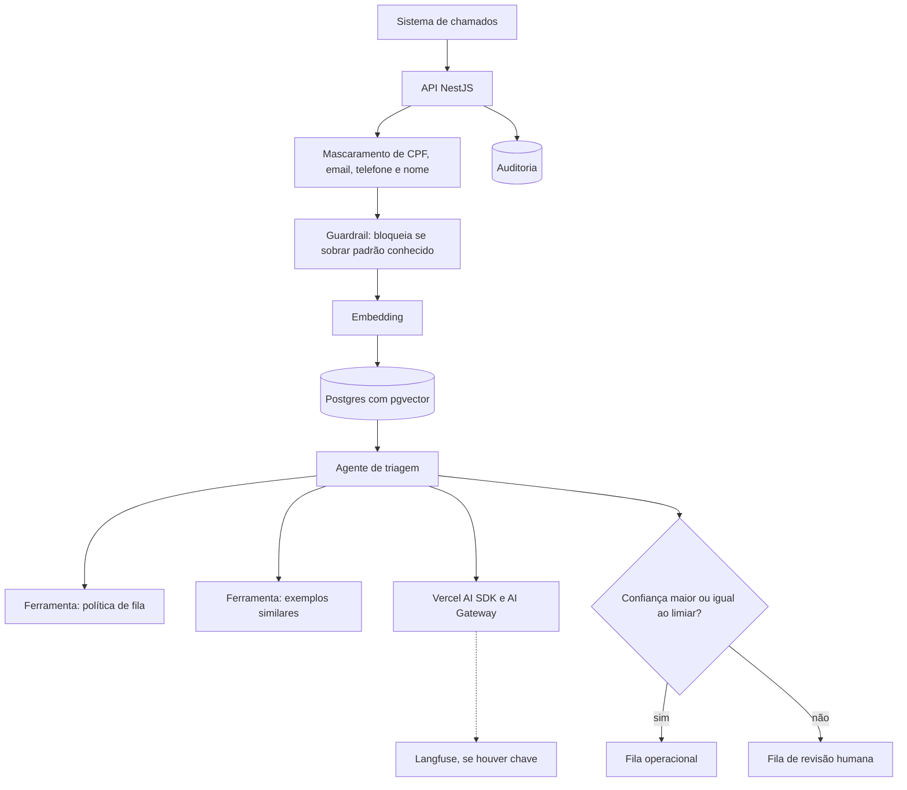

# Triagem de chamados com LGPD

A API classifica chamados de suporte escritos em português informal (categoria, prioridade e fila). Antes de qualquer embedding ou chamada de modelo, ela mascara CPF, email, telefone e nome nos formatos que o detector conhece. A cobertura tem limites conhecidos, listados em [Limites do mascaramento](#limites-do-mascaramento).

O cenário é um helpdesk interno de uma empresa fictícia de atacado. O sistema de chamados continua dono do texto original. Este serviço só devolve a triagem e guarda a versão mascarada.

## Problema

Um time de suporte recebe texto solto: "não tô conseguindo login, a senha fica inválida", misturado com CPF e telefone. Alguém precisa escolher a fila. Um modelo ajuda, com três restrições:

- o dado pessoal não vai para o provedor do modelo
- a saída tem de ser estruturada, com categoria, prioridade, fila e confiança
- caso incerto vai para uma pessoa, e a decisão fica auditável

## O que o projeto cobre

- Agente com o Vercel AI SDK (`ToolLoopAgent`), duas ferramentas (`buscar_exemplos` e `politica_de_fila`) e saída Zod (`Output.object`)
- Few-shot por vizinhos. No modo padrão, o índice fica em memória, com embedding por hash de n-gramas. A versão em Postgres com pgvector está escrita, mas nunca foi executada
- Mascaramento antes do embedding e do agente, com uma checagem em cada fronteira. A checagem roda o mesmo detector do mascaramento: ela protege contra um caminho que esqueça de mascarar, não contra um formato que o detector não conhece
- Limiar de confiança e fila de revisão humana
- Log de auditoria sem o texto cru
- Avaliação com precisão, recall, F1 por classe e matriz de confusão
- Comparação de custo entre três modelos do AI Gateway, escrita mas nunca executada com chave
- Langfuse opcional, ligado só quando as variáveis existem
- API NestJS, Docker e um esqueleto Terraform de ECS Fargate na `sa-east-1`

A decisão de privacidade está no [ADR 0001](docs/adr/0001-lgpd-mascaramento-e-revisao.md).

## Arquitetura



O fluxo de um `POST /chamados`:

1. Mascara o texto e calcula o SHA-256 do original.
2. O guardrail roda de novo. Se ainda houver CPF, email, telefone ou nome no formato coberto, a chamada para e o audit log grava só o hash e os tipos. Como ele usa o mesmo detector, depois do mascaramento ele não dispara.
3. Gera o embedding do texto mascarado e busca até 4 exemplos no pgvector.
4. O agente devolve categoria, prioridade, fila, confiança e uma justificativa curta.
5. Confiança abaixo de 0,72 manda o chamado para `fila_revisao`. O modelo não escolhe essa fila.
6. A auditoria grava a decisão. O corpo do chamado guardado é o texto mascarado.

Sem `AI_GATEWAY_API_KEY`, o mesmo fluxo usa um classificador heurístico local. Os testes e o GitHub Actions usam esse caminho. O caminho com modelo nunca rodou com chave.

## Limites do mascaramento

O detector junta regex de formato fixo com uma lista fixa de nomes e sobrenomes. Um nome fora da lista só é pego depois de um gatilho como "me chamo" ou "aqui é o". Estes exemplos passam sem máscara:

- nome fora da lista, sem gatilho: "o Thiago Lima do financeiro nao consegue logar";
- assinatura: "Att, Thiago Lima";
- CPF com espaços: "390 533 447 05";
- telefone com espaço ou ponto: "11 98888 7777" e "51 99876.5432".

Também há falso positivo que muda o sentido do texto: "a loja de São Paulo" vira "a loja de São [NOME_1]".

Outros limites:
- o campo `referenciaExterna` não passa pelo mascaramento;
- o `hashOriginal` é um SHA-256 sem sal do texto cru;
- o dataset e os testes usam nomes da própria lista do mascarador, então não medem a cobertura com nomes que ele não conhece.

## Como rodar

Requer Node.js 22 ou superior.

```bash
npm install
npm test
npm run avaliar
npm run start:dev
```

A API sobe em `http://localhost:3000` com repositório em memória. Os exemplos de treino do dataset entram nesse índice local, e a classificação não precisa de Docker nem de chave.

```bash
curl -s localhost:3000/saude
curl -s localhost:3000/chamados \
  -H 'content-type: application/json' \
  -d '{"texto":"vei, nao to conseguindo passar da primeira tela do erp desde ontem. meu cpf e 390.533.447-05","referenciaExterna":"HD-1"}'
curl -s localhost:3000/revisao
```

A resposta traz `textoMascarado` com `[CPF_1]`. Nesse formato, o CPF original não volta na API, na revisão nem na auditoria. Escrito com espaços, ele passa cru (ver [Limites do mascaramento](#limites-do-mascaramento)).

### Postgres e pgvector

```bash
docker compose up -d postgres
cp .env.example .env
npm run migrar
npm run seed
npm run start:dev
```

`npm run seed` grava só o texto mascarado. O identificador do embedding fica em `metadados`. Com `USAR_EMBEDDING_GATEWAY=true`, rode o seed de novo: vetor local e vetor do gateway ocupam espaços diferentes. Se o identificador divergir, a busca de exemplos desliga.

`docker compose up --build` sobe a API e o Postgres. O seed continua sendo um comando à parte, no host, com `DATABASE_URL` apontando para `localhost:5432`.

### Avaliação com modelos pagos

O script `npm run avaliar` sempre mede o heurístico. A comparação entre modelos só chama o gateway com as duas variáveis:

```bash
AI_GATEWAY_API_KEY=... AVALIACAO_REAL=true npm run avaliar
```

Modelos padrão, conferidos no catálogo `https://ai-gateway.vercel.sh/v1/models` em 20/11/2026:

| modelo | USD por 1M tokens, entrada / saída | papel |
| --- | --- | --- |
| `openai/gpt-5-nano` | 0,05 / 0,40 | opção barata |
| `google/gemini-2.5-flash-lite` | 0,10 / 0,40 | padrão da API |
| `anthropic/claude-haiku-4.5` | 1,00 / 5,00 | opção mais cara do trio |

O preço usado no relatório vem desse catálogo (`pricing.input` e `pricing.output`, USD por token). Com rede, o script tenta atualizar a tabela ao vivo e usa a cópia de 20/11/2026 se o catálogo falhar.

Langfuse: preencha `LANGFUSE_PUBLIC_KEY`, `LANGFUSE_SECRET_KEY` e, se precisar, `LANGFUSE_BASE_URL`. Sem as chaves, nenhum trace sai. `LANGFUSE_REGISTRAR_CONTEUDO=false` tira o texto mascarado e a saída do trace. O que segue para o Langfuse já passou pelo mascaramento.

## Dataset

`dataset/chamados.jsonl` tem 300 chamados sintéticos, gerados por `npm run dataset` com semente 42. 239 ficam no treino e 61 no holdout. 146 trazem CPF, email, telefone ou nome inventados para exercitar o mascaramento.

O texto varia de uma frase curta a um relato com saudação, contexto e ruído. Entram gíria, erro de digitação, dois assuntos no mesmo chamado e casos em que duas categorias são defensáveis. O rótulo é a intenção da cena. No tipo ambíguo, outro leitor pode discordar. A prioridade sai da situação (loja parada, pessoa esperando, "dá para ver depois"), e só uma parte dos chamados usa uma palavra explícita como "hoje" ou "urgente".

| tipo | quantidade | o que é |
| --- | --- | --- |
| direto | 123 | um assunto, com vocabulário e tamanho variados |
| misto | 99 | dois assuntos. O rótulo é o principal |
| ambiguo | 78 | duas leituras defensáveis. O rótulo é a intenção de quem escreveu a cena |

Categorias: acesso, pagamento, bug, cadastro, entrega, dúvida. Prioridades: baixa, média, alta, urgente. A fila operacional sai de uma política fixa em `src/agente/politica.ts` (acesso urgente ou VPN vai para infra, bug de prioridade baixa vai para atendimento, e o restante segue a classe). Num chamado misto, uma palavra da política pode puxar a fila.

Exemplo real do arquivo (`ch-0020`, direto):

```text
vei nao to conseguindo passar da primeira tela do erp desde ontem. me chama no 61946198325, email juliana.oliveira40@exemplo.com.
```

Rótulo: acesso, média, `fila_acessos`. O texto não diz "login" nem "senha", e não fecha com uma frase de prioridade.

## Métricas

Rodada em 20/11/2026 (`eval/resultados/ultimo.json`, `geradoEm` `2026-11-20T02:41:55.649Z`). Holdout de 61 chamados. Limiar 0,72. Esta rodada não usou chave de modelo: os números são do classificador heurístico local, com custo 0 USD e 0 tokens. A tabela dos LLMs continua vazia de propósito: ela só enche com `AI_GATEWAY_API_KEY` e `AVALIACAO_REAL=true`.

O baseline conta palavras. A busca vetorial entra no prompt do agente e no campo `exemplosUsados`. O voto dos vizinhos fica de fora da conta do heurístico, para o F1 continuar interpretável.

Os números medem mais o dataset do que o classificador:
- **Mistura do gerador.** O gerador escreve parte dos chamados com as palavras que o heurístico procura e parte sem nenhuma delas. No holdout, o heurístico acerta 26 de 27 itens do primeiro grupo e 0 de 19 do segundo, então a acurácia de categoria mede sobretudo essa mistura.
- **Holdout parecido com o treino.** 47 dos 61 itens do holdout têm no treino a mesma frase-base com o mesmo rótulo. Isso deve inflar a nota de um LLM com few-shot.
- **Fila.** O rótulo de fila sai da mesma política usada na previsão, então a métrica de fila acrescenta pouco à de categoria.

Na prioridade, o heurístico cai em média quando não vê "hoje", "urgente", "sem pressa" e outras poucas expressões. A maior parte do conjunto só implica a urgência pela situação. Por isso o recall de média fica alto (0,952) e o de baixa fica baixo (0,077). O F1 macro de 0,469 é esse piso lexical, neste holdout.

A confiança do heurístico é 0,42 + 0,55 × margem. Um único sinal dá sempre 0,695, logo abaixo do limiar de 0,72, que não foi calibrado. Por isso 46 dos 61 chamados iriam para revisão, e a taxa de 0,754 vem da fórmula e do limiar. Nos 15 que passam, a categoria acerta 12.

### Resumo do heuristico-local

| tarefa | acurácia | F1 macro | F1 ponderado |
| --- | --- | --- | --- |
| categoria | 0,607 (37/61) | 0,625 | 0,626 |
| prioridade | 0,508 (31/61) | 0,469 | 0,451 |
| fila prevista | 0,590 (36/61) | 0,661 | 0,604 |

Taxa de revisão: 0,754 (46/61). Acurácia de categoria quando a confiança passa do limiar: 0,800 (12/15). Quando cai para a revisão: 0,543 (25/46).

No holdout, por tipo de texto: direto 0,714 (15/21), misto 0,440 (11/25), ambíguo 0,733 (11/15). O misto é onde o léxico mais erra, porque o outro assunto também deixa palavra. No ambíguo o baseline ainda agarra o sinal mais forte, mesmo com uma segunda leitura possível.

### Categoria, por classe

| classe | precisão | recall | F1 | suporte |
| --- | --- | --- | --- | --- |
| acesso | 1,000 | 0,700 | 0,824 | 10 |
| pagamento | 1,000 | 0,500 | 0,667 | 10 |
| bug | 0,778 | 0,636 | 0,700 | 11 |
| cadastro | 0,571 | 0,800 | 0,667 | 10 |
| entrega | 0,545 | 0,600 | 0,571 | 10 |
| duvida | 0,267 | 0,400 | 0,320 | 10 |

Matriz de confusão da categoria. Linha é o rótulo, coluna é a previsão, na ordem acesso, pagamento, bug, cadastro, entrega, duvida:

```text
7 0 1 0 0 2
0 5 0 0 2 3
0 0 7 0 1 3
0 0 0 8 1 1
0 0 0 2 6 2
0 0 1 4 1 4
```

### Prioridade, por classe

| classe | precisão | recall | F1 | suporte |
| --- | --- | --- | --- | --- |
| baixa | 1,000 | 0,077 | 0,143 | 13 |
| media | 0,417 | 0,952 | 0,580 | 21 |
| alta | 0,714 | 0,263 | 0,385 | 19 |
| urgente | 1,000 | 0,625 | 0,769 | 8 |

Matriz da prioridade. Linha é o rótulo, coluna é a previsão, na ordem baixa, media, alta, urgente:

```text
1 12 0 0
0 20 1 0
0 14 5 0
0 2 1 5
```

### Fila prevista, por classe

| classe | precisão | recall | F1 | suporte |
| --- | --- | --- | --- | --- |
| fila_acessos | 1,000 | 0,667 | 0,800 | 9 |
| fila_infra | 1,000 | 1,000 | 1,000 | 1 |
| fila_financeiro | 1,000 | 0,444 | 0,615 | 9 |
| fila_engenharia | 0,700 | 0,636 | 0,667 | 11 |
| fila_cadastro | 0,571 | 0,800 | 0,667 | 10 |
| fila_logistica | 0,545 | 0,600 | 0,571 | 10 |
| fila_atendimento | 0,267 | 0,364 | 0,308 | 11 |

`fila_infra` tem suporte 1 neste holdout. O 1,000 dessa linha é um único chamado. A matriz completa está em `eval/resultados/ultimo.json`.

### Comparativo de modelos

Os números abaixo são só do baseline heurístico. As três linhas de modelo ficam em branco até a rodada com chave. O JSON já tem o formato: acurácia, F1, matriz, tokens e `custoEstimadoUsd`.

| modelo | acurácia categoria | F1 macro categoria | acurácia fila | taxa de revisão | custo USD no holdout |
| --- | --- | --- | --- | --- | --- |
| heuristico-local | 0,607 | 0,625 | 0,590 | 0,754 | 0 |
| openai/gpt-5-nano |  |  |  |  |  |
| google/gemini-2.5-flash-lite |  |  |  |  |  |
| anthropic/claude-haiku-4.5 |  |  |  |  |  |

## API

| método | caminho | função |
| --- | --- | --- |
| GET | `/saude` | banco, embedding, estado dos exemplos, limiar, Langfuse |
| POST | `/chamados` | `{ texto, referenciaExterna? }` |
| GET | `/chamados/:id` | triagem mascarada |
| GET | `/revisao` | fila humana, mais antigos primeiro |
| POST | `/revisao/:id/decisao` | categoria, prioridade, fila e comentário. O comentário também é mascarado |
| GET | `/auditoria?chamadoId=` | eventos da decisão |

## AWS

O Terraform em `infra/terraform` sobe VPC, ALB, ECS Fargate, RDS PostgreSQL criptografado e segredos no Secrets Manager. A região padrão é `sa-east-1`. A task usa IP público para chegar ao ECR e ao AI Gateway. O banco aceita conexão só do security group da API. A migração da aplicação cria a extensão `vector`.

Este esqueleto não foi aplicado. Falta conta AWS, imagem no ECR e a chave do gateway.

```bash
cd infra/terraform
terraform init
terraform apply -var 'imagem_container=123456789012.dkr.ecr.sa-east-1.amazonaws.com/triagem:1'
```

Ajuste `versao_postgres` para uma versão 16 disponível na região. O listener do balanceador está na porta 80. O passo seguinte é certificado no ACM e redirect para 443.

Antes de aplicar, considere dois pontos:
- A API não tem autenticação. Com o Terraform como está, a fila de revisão e a auditoria ficam abertas na internet, e qualquer pessoa grava decisões.
- O RDS PostgreSQL 16 exige SSL por padrão, e a conexão da aplicação não configura SSL.

## Testes e CI

`npm test` cobre o mascaramento, o guardrail que impede a chamada ao modelo, o limiar de revisão, a métrica de F1, o contrato do dataset e a API HTTP. `npm run avaliar` repete o holdout. O workflow `.github/workflows/ci.yml` roda typecheck, testes, avaliação heurística e build. Nenhum dos dois gasta crédito de modelo.

## Próximos passos

- Medir o recall do mascaramento com PII que o gerador não conhece e cobrir os formatos de [Limites do mascaramento](#limites-do-mascaramento)
- Autenticação na API antes de qualquer deploy
- Separar o holdout por frase-base, para o few-shot não ver o gêmeo do item avaliado
- Rodar o trio de modelos no holdout e preencher a tabela de custo versus acurácia
- Calibrar o limiar com o custo de um urgente errado e o custo da fila humana
- Trocar o conjunto sintético por chamados reais já anonimizados, rotulados com o time de suporte
- Guardar o texto original criptografado com KMS, numa base separada da que o modelo enxerga
- Acrescentar consenso entre dois modelos antes de automatizar a fila
- Acompanhar drift semanal da distribuição de categorias
- Fechar retenção no AI Gateway e, se o contrato pedir, um modelo hospedado no Brasil
